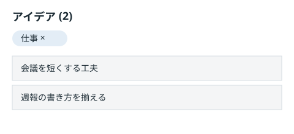

# 最終仕様: タグで絞り込む

## 基本の仕様

一覧の上の「タグ」欄でタグを選ぶと、そのタグを持つアイデアだけが一覧に出る。

- タグは複数選べる。どれか1つでも持つアイデアを出す
- 何も選んでいない時は、すべてのアイデアを出す
- 見出しの件数は、出ている件数にする(例: `アイデア (3)`)

## 詳しい仕様

| 条件 | 一覧 | 見出し |
|---|---|---|
| タグを選んでいない | すべて | `アイデア (全件数)` |
| 1つ選んだ | そのタグを持つもの | `アイデア (出ている件数)` |
| 2つ以上選んだ | どれか1つでも持つもの | 同上 |
| 選んだタグを持つものが無い | `該当するアイデアはありません` | `アイデア (0)` |

## スコープ外

- タグの名前の変更・削除
- 「すべてのタグを持つ」での絞り込み

## 判断基準

| 観点 | 要否 | わけ |
|---|---|---|
| 権限 | 不要 | 一覧を見られる人は、全員が絞り込める |
| データ移行 | 不要 | 新しいデータは持たない |
| 既存データへの影響 | 確認済み | タグの無いアイデアは、絞り込むと出なくなる。選んでいない時は今と同じ |
