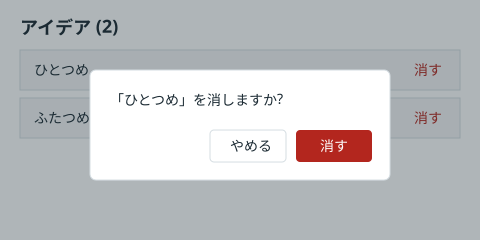

# 最終仕様: アイデアを消す

## 基本の仕様

一覧の行の「消す」を押すと確かめの窓が出て、「消す」を押すとそのアイデアが消える。

- 確かめの窓の文言: `「<アイデアの名前>」を消しますか?`、ボタンは「消す」「やめる」
- 消したら、知らせ `消しました` を出し、見出しの件数を減らす(例: `アイデア (1)`)
- 「やめる」を押したら、何も変えずに窓を閉じる

## 詳しい仕様

| 条件 | 一覧 | 見出し | 知らせ |
|---|---|---|---|
| 2件あるうちの1件を消す | 残りの1件 | `アイデア (1)` | `消しました` |
| 最後の1件を消す | 案内 `まだアイデアがありません` | `アイデア (0)` | `消しました` |
| 確かめの窓で「やめる」 | 押す前と同じ | 押す前と同じ | 出ない |
| 消している間に通信が失敗した | 押す前と同じ | 押す前と同じ | `消せませんでした。もう一度お試しください` |

## スコープ外

- まとめて消す
- 消したアイデアを戻す(ごみ箱)

## 判断基準

| 観点 | 要否 | わけ |
|---|---|---|
| 権限 | 不要 | 自分のアイデアしか一覧に出ない |
| データ移行 | 不要 | 新しいデータは持たない |
| 既存データへの影響 | 確認済み | 消すのは押した1件だけ。ほかの行と、追加の動きは今と同じ |
